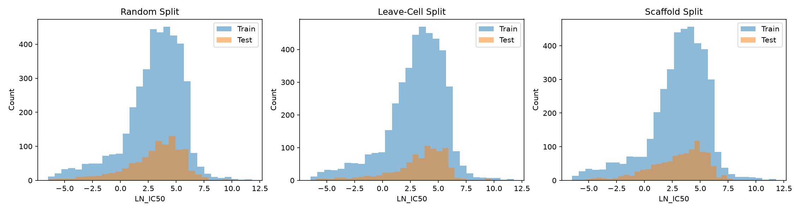
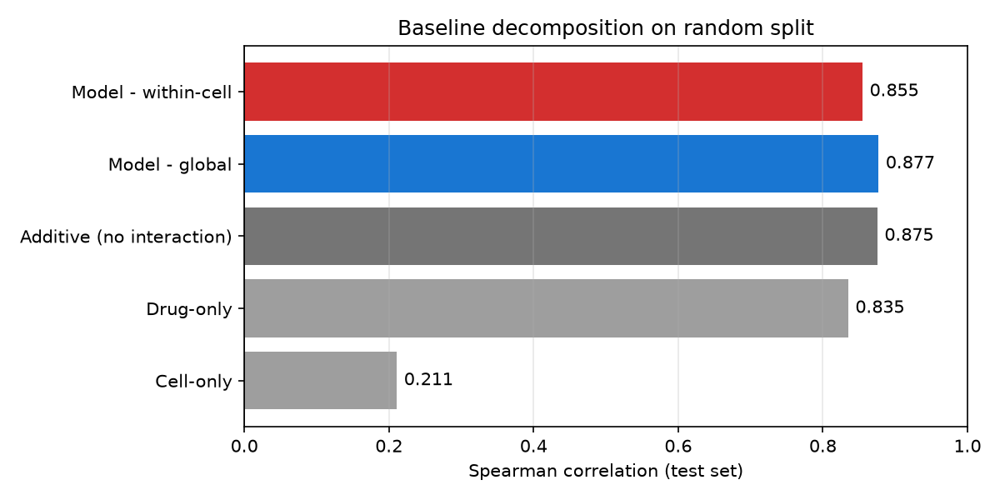
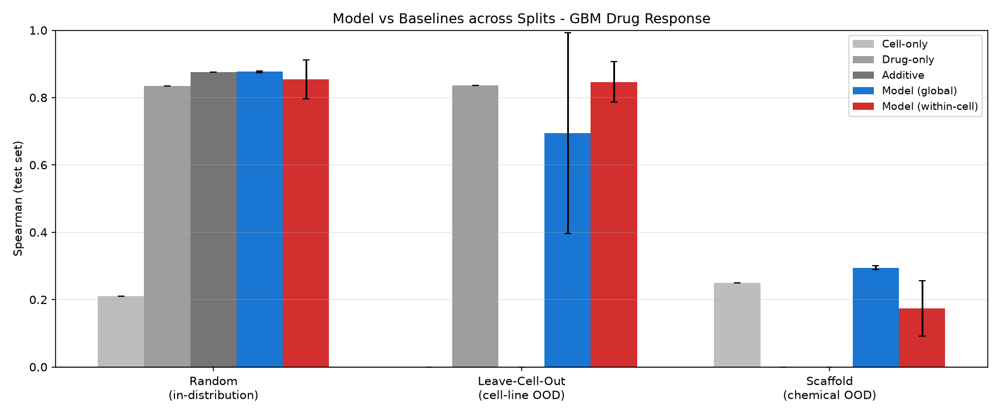
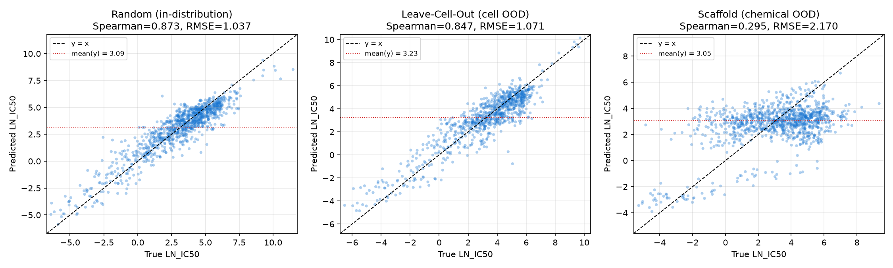
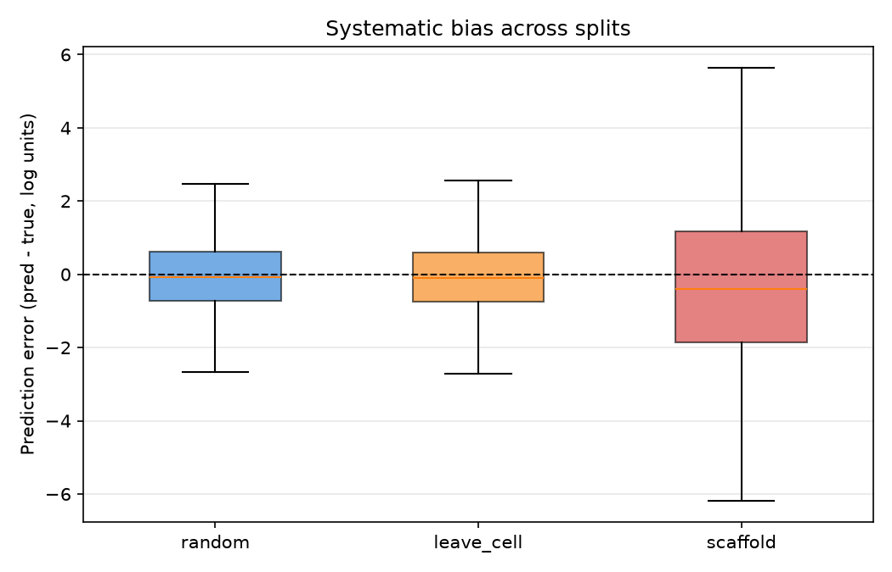
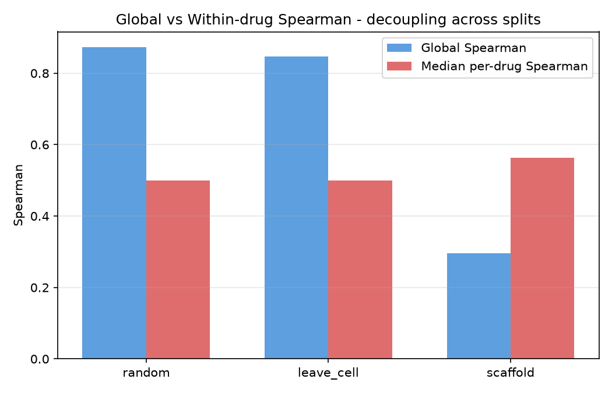
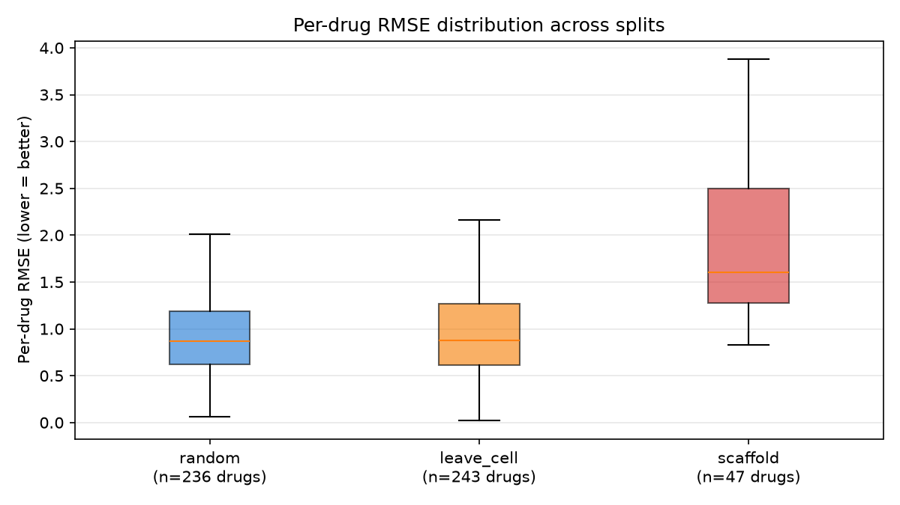
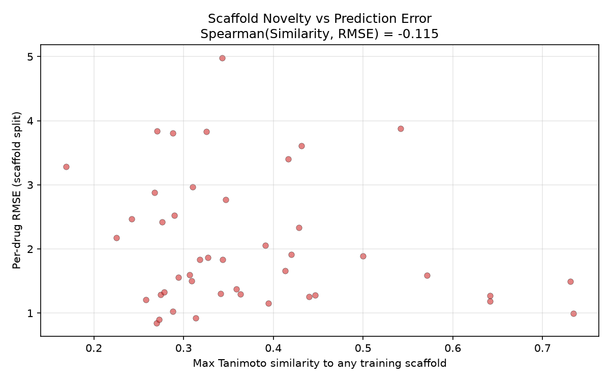

# Deep Learning for Glioblastoma (GBM) Drug Response Prediction & Out-of-Distribution (OOD) Generalization

**Course Final Mini-Project**: *Deep Learning in Healthcare AI*

---

## 1. Project Overview & Scientific Question

Predicting patient-specific or cell-line-specific anticancer drug sensitivity (`LN_IC50`) from multimodal biological and chemical data is a foundational problem in precision oncology. However, standard **in-distribution random splits** often overestimate model clinical utility due to **shortcut learning** (e.g., memorizing drug-level mean potencies rather than learning true drug–cell biological interactions).

This repository implements an end-to-end, leakage-free multimodal deep learning benchmark for **Glioblastoma (GBM)** drug response prediction integrating **GDSC2** dose-response records, **DepMap** multi-omics profiles (gene expression, somatic hotspot mutations, and `MGMT` promoter methylation/expression), and **RDKit** molecular structures. We systematically evaluate a **Two-Tower Multi-Layer Perceptron (`BaselineMLP`)** against non-deep-learning statistical and chemical-similarity baselines across three evaluation regimes:
1. **Random Split (In-Distribution)**: Random `(drug, cell_line)` pair holdout ($80\%$ train / $20\%$ test).
2. **Leave-Cell-Out Split (Biological OOD)**: Strict holdout of unseen GBM cell lines (`ModelID`).
3. **Bemis-Murcko Scaffold Split (Chemical OOD)**: Strict holdout of unseen chemical core scaffolds.

---

## 2. Software Architecture & Design Principles

Following industry-grade healthcare AI engineering standards, `src/` is structured into two cleanly separated layers adhering to the **Single Responsibility Principle (SRP)**:

1. **Atomic Domain Modules (`src/*.py`)**: Pure, single-purpose modules that each execute exactly one algorithmic, statistical, or data-hygiene responsibility (`config.py`, `utils.py`, `acquisition.py`, `deduplication.py`, `fingerprints.py`, `splitting.py`, `standardization.py`, `pipeline_audit.py`, `eda.py`, `baselines.py`, `dataset.py`, `mlp_model.py`, `mlp_training.py`, `uncertainty.py`, `results_analysis.py`).
2. **Stage Workflow Orchestrators (`src/*_workflow.py` & `src/workflow.py`)**: High-level pipeline coordinators (`split_workflow.py`, `baseline_workflow.py`, `mlp_workflow.py`, `uncertainty_workflow.py`, `workflow.py`) that connect atomic modules and manage artifact persistence.
3. **1-to-1 Unit Test Mirroring (`tests/test_*.py`)**: Every module in `src/` has a dedicated, self-contained unit test file in `tests/` powered by synthetic multi-omics fixtures (`tests/fixtures/synthetic_data.py`), enabling full CI verification in $<5$ seconds without requiring multi-gigabyte raw CSVs.

---

## 3. Repository Directory Tree

```text
gbm_drug_response_project/
├── .github/
│   └── workflows/
│       └── ci.yml                              # GitHub Actions CI: runs pytest & anti-leakage audit on every push
├── Data/                                       # Raw GDSC2, DepMap multi-omics, and SMILES datasets (Git-ignored)
│   └── .gitkeep                                # Preserves empty Data/ folder structure in Git
├── Models/                                     # Cached splits (.pkl), model checkpoints (.pt), OOD results (Git-ignored)
│   └── .gitkeep                                # Preserves empty Models/ folder structure in Git
├── Notebooks/                                  # Archive of original exploratory Jupyter Notebooks
│   ├── 01_data_pipeline.ipynb
│   ├── 02_models_and_training.ipynb
│   ├── 03_OOD.ipynb
│   └── 04_Error Analysis and Visualization.ipynb
├── Results/                                    # Publication-ready diagnostic figures (.png)
│   ├── three_split.png
│   ├── diag_spearman_decomposition.png
│   ├── OOD_three_split_comparison.png
│   ├── OOD_scatter_three_splits.png
│   ├── OOD_per_drug_rmse_box.png
│   ├── OOD_per_drug_spearman_scaffold.png
│   ├── OOD_prediction_bias_box.png
│   ├── OOD_global_vs_within_drug_spearman.png
│   └── OOD_scaffold_novelty_vs_error.png
├── src/                                        # Modular Python package (15 Atomic Modules + 5 Workflows)
│   ├── __init__.py
│   ├── config.py                               # Centralized pathlib paths, hyperparameters & GBM drug constants
│   ├── utils.py                                # Seed fixing, CUDA/MPS GPU device management & string helpers
│   ├── acquisition.py                          # Raw GDSC2, DepMap expression, mutation & methylation ingestion
│   ├── deduplication.py                        # Replicate IC50 averaging, SMILES deduplication & table merging
│   ├── fingerprints.py                         # RDKit 2048-bit Morgan fingerprints, Murcko scaffolds & Tanimoto
│   ├── splitting.py                            # Pure OOD splitting: Random, Leave-Cell-Out & Scaffold
│   ├── standardization.py                      # Train-only StandardScaler, PCA, MGMT median & Z-score scaling
│   ├── pipeline_audit.py                       # Programmatic anti-leakage & feature matrix integrity auditor
│   ├── eda.py                                  # Cohort exploratory statistics & split distribution histograms
│   ├── split_workflow.py                       # Stage 1 workflow: Acquisition -> Split -> PCA -> Audit
│   ├── baselines.py                            # Cell-only, Drug-only, Additive & Nearest-Drug FP baselines
│   ├── baseline_workflow.py                    # Stage 2 workflow: Statistical baseline decomposition
│   ├── dataset.py                              # PyTorch DrugResponseDataset & GPU DataLoader (pin_memory=True)
│   ├── mlp_model.py                            # Two-Tower BaselineMLP neural network architecture
│   ├── mlp_training.py                         # Single-epoch GPU/CPU training, early stopping & evaluation
│   ├── mlp_workflow.py                         # Stage 3 workflow: Multi-split x multi-seed OOD training
│   ├── uncertainty.py                          # Multi-seed stability, Seed 2 collapse & variance shrinkage
│   ├── uncertainty_workflow.py                 # Stage 4 workflow: Uncertainty & shrinkage diagnostics
│   ├── results_analysis.py                     # Stage 5 workflow: Per-drug/cell errors, subtypes & 8 plots
│   └── workflow.py                             # Master end-to-end workflow orchestrator
├── scripts/                                    # Numbered step-by-step reproducible execution scripts
│   ├── 01_preprocess_and_split.py              # Step 01: Run multi-omics preprocessing, splitting & audit
│   ├── 02_evaluate_baselines.py                # Step 02: Evaluate statistical & nearest-drug baselines
│   ├── 03_train_ood_models.py                  # Step 03: Train Two-Tower MLP across 3 splits x 5 seeds (GPU/CPU)
│   ├── 04_uncertainty_and_shrinkage.py         # Step 04: Run seed stability & variance shrinkage diagnostics
│   ├── 05_error_analysis_and_plots.py          # Step 05: Generate Top-K error tables, subtype stats & figures
│   └── 06_validate_pipeline.py                 # Step 06: Zero-CSV synthetic smoke test & leakage audit (<3s)
├── tests/                                      # Modular 1-to-1 unit test suite (20 test modules, 45 unit tests)
│   ├── __init__.py
│   ├── fixtures/
│   │   ├── __init__.py
│   │   └── synthetic_data.py                   # Synthetic multi-omics & SMILES generator for fast testing
│   ├── test_acquisition.py
│   ├── test_baseline_workflow.py
│   ├── test_baselines.py
│   ├── test_config.py
│   ├── test_dataset.py
│   ├── test_deduplication.py
│   ├── test_eda.py
│   ├── test_fingerprints.py
│   ├── test_mlp_model.py
│   ├── test_mlp_training.py
│   ├── test_mlp_workflow.py
│   ├── test_pipeline_audit.py
│   ├── test_results_analysis.py
│   ├── test_split_workflow.py
│   ├── test_splitting.py
│   ├── test_standardization.py
│   ├── test_uncertainty.py
│   ├── test_uncertainty_workflow.py
│   ├── test_utils.py
│   └── test_workflow.py
├── main.py                                     # Unified command-line entry point
├── pyproject.toml                              # Modern Python PEP 621 package & pytest configuration
├── requirements.txt                            # Python dependencies
├── LICENSE                                     # MIT Open-Source License
├── .gitignore                                  # Git ignore rules for large CSVs, model weights & virtualenvs
└── README.md                                   # Project documentation
```

---

## 4. Data Preparation (`Data/`)

Because raw multi-omics matrices and dose-response tables exceed GitHub file size limits, they are excluded via `.gitignore`. To run the full training pipeline from scratch, place the following files inside the `Data/` directory:

| File Name | Source | Description |
| :--- | :--- | :--- |
| `GDSC2_fitted_dose_response_27Oct23.csv` | GDSC2 | Fitted dose-response `LN_IC50` records filtered for Glioblastoma (`CANCER_TYPE`) |
| `Model.csv` | DepMap | Cell-line metadata mapping `SangerModelID` and `CellLineName` to `ModelID` (`ACH-*`) and `OncotreeSubtype` |
| `OmicsExpressionProteinCodingGenesTPMLogp1BatchCorrected.csv` | DepMap | Batch-corrected $\log_2(\text{TPM}+1)$ protein-coding gene expression ($19,138$ genes) |
| `OmicsSomaticMutationsMatrixHotspot.csv` | DepMap | Somatic hotspot mutation matrix ($20$ active hotspot genes in GBM cohort) |
| `CCLE_RRBS_TSS_1kb_20180614.txt` | CCLE / DepMap | Promoter methylation ($\text{TSS } 1\text{kb}$) tab-delimited matrix |
| `drug_smiles.csv` | PubChem / GDSC | Canonical SMILES strings (`drug_name`, `canonical_smiles`) for RDKit featurization |

> **Note**: You can run the complete unit test suite (`pytest -v`) and end-to-end synthetic pipeline validation (`python scripts/06_validate_pipeline.py`) **immediately without downloading any CSV files**.

---

## 5. Quick Start & Execution Guide

### 5.1 Activate Virtual Environment & Install Dependencies
```bash
# Linux / macOS:
source .vene/bin/activate
# Windows (PowerShell):
.vene\Scripts\Activate.ps1

pip install -r requirements.txt
pip install -e .                 # Optional: install package in editable mode
```

*(Optional GPU Acceleration)*: If training on an NVIDIA CUDA GPU, ensure CUDA-enabled PyTorch is installed in `.vene`:
```bash
pip install torch --index-url https://download.pytorch.org/whl/cu121
```

### 5.2 Run Automated Unit Tests & Anti-Leakage Audit (No Raw CSVs Required)
```bash
# Run all 45 unit tests across the 20 test modules:
pytest -v
# Or using standard library unittest:
python -m unittest discover -s tests -v

# Run the <3s synthetic end-to-end smoke validation & anti-leakage audit:
python scripts/06_validate_pipeline.py
```

### 5.3 Run the Full Pipeline (Unified CLI or Step-by-Step Scripts)
```bash
# Option A: Execute the entire 5-stage pipeline via main.py
python main.py --stage all --device auto

# Option B: Execute individual pipeline stages step-by-step via scripts/
python scripts/01_preprocess_and_split.py
python scripts/02_evaluate_baselines.py
python scripts/03_train_ood_models.py --seeds 5 --epochs 100 --device auto
python scripts/04_uncertainty_and_shrinkage.py
python scripts/05_error_analysis_and_plots.py
```

---

## 6. Key Experimental Results & Visual Diagnostics

After deduplication and multi-omics alignment, the final GBM cohort comprises **$5,107$ unique `(drug, cell_line)` pairs** spanning **$24$ GBM/Gliosarcoma cell lines** and **$243$ unique drugs**.

### 6.1 Quantitative Benchmark Across Evaluation Regimes ($5$ Random Seeds)

| Split Regime | Cell-Only Baseline (Spearman) | Drug-Only Baseline (Spearman) | Additive Baseline (No Interaction) | Nearest-Drug FP Baseline | Two-Tower `BaselineMLP` Global Spearman | Two-Tower `BaselineMLP` Global RMSE | Within-Cell `BaselineMLP` Spearman | Within-Cell Drug-Only Spearman |
| :--- | :---: | :---: | :---: | :---: | :---: | :---: | :---: | :---: |
| **Random (In-Distribution)** | $0.2107$ | $0.8349$ | $0.8752$ | — | **$0.8744 \pm 0.0051$** | **$1.0346 \pm 0.0211$** | $0.8541 \pm 0.0576$ | $0.8554 \pm 0.0598$ |
| **Leave-Cell-Out (Cell OOD)** | N/A | $0.8362$ | N/A | — | $0.6947 \pm 0.2979^*$ | $1.3970 \pm 0.6115^*$ | **$0.8460 \pm 0.0608$** | $0.8449 \pm 0.0602$ |
| **Scaffold (Chemical OOD)** | $0.2494$ | N/A ($0\%$ cov) | N/A | $0.1445$ | **$0.2905 \pm 0.0045$** | $2.1951 \pm 0.0081$ | $0.1735 \pm 0.0813$ | N/A |

*\*Note on Leave-Cell-Out Multi-Seed Stability*: Four of the five seeds (`seed=0, 1, 3, 4`) converge stably to a global Spearman of **$0.8388\text{–}0.8476$** (RMSE **$1.0823\text{–}1.1034$**), whereas `seed=2` experiences early-stopping collapse at epoch 21 (Spearman $0.0989$, RMSE $2.6199$), automatically flagged by `src/uncertainty.py`.

---

### 6.2 Key Scientific Findings & Diagnostic Figures

1. **Leakage-Free Split Distributions (`Results/three_split.png`)**:
   Train and test `LN_IC50` distributions remain well-aligned across Random, Leave-Cell-Out, and Scaffold splits after strictly fitting `StandardScaler`, `PCA`, and `MGMT` median imputation on training cell lines only.
   

2. **Shortcut Learning & Baseline Decomposition (`Results/diag_spearman_decomposition.png` & `Results/OOD_three_split_comparison.png`)**:
   On the in-distribution Random split, a non-deep-learning **Additive Baseline** (`drug_mean + cell_mean - global_mean`) achieves Spearman $= 0.8752$, matching the deep `BaselineMLP` ($0.8744$). Within individual cell lines, ranking drugs by their training mean (`Within-Cell Drug-Only` $= 0.8554$) matches the neural network ($0.8541$), demonstrating that apparent in-distribution performance is overwhelmingly driven by between-drug potency variance rather than complex drug–cell interaction learning.
   
   

3. **Chemical OOD Collapse & Prediction Variance Shrinkage (`Results/OOD_scatter_three_splits.png` & `Results/OOD_prediction_bias_box.png`)**:
   When generalizing to unseen chemical scaffolds (`Scaffold` split), global Spearman drops from $0.8744$ to **$0.2905$** (still outperforming Nearest-Drug Morgan FP similarity at $0.1445$). Variance analysis (`src/uncertainty.py`) reveals severe **prediction shrinkage toward the prior mean**: the ratio $\sigma(\hat{y}) / \sigma(y)$ contracts from **$0.862$** (Random) and **$0.852$** (Leave-Cell-Out) down to **$0.663$** (Scaffold), with $36.8\%$ of test predictions exhibiting $|\text{error}| > 2.0$ log units (e.g., systematically under-predicting `LN_IC50` for **Temozolomide** by $-3.13$ log units and **Irinotecan** by $-3.78$ log units).
   
   

4. **Decoupling Between Global Spearman and Within-Drug Spearman (`Results/OOD_global_vs_within_drug_spearman.png`, `Results/OOD_per_drug_spearman_scaffold.png`, `Results/OOD_per_drug_rmse_box.png`)**:
   Crucially, while **global Spearman** collapses on the Scaffold split ($0.292$), the **median within-drug Spearman across cell lines** remains **$0.530$** (compared to $0.500$ on Random and $0.500$ on Leave-Cell-Out). Thus, the cell-line encoder successfully preserves relative cell-line sensitivity ordering *within* a given drug, and the chemical OOD failure is primarily caused by inability to calibrate the **per-drug baseline potency offset** for novel chemical scaffolds.
   
   

5. **Chemical Scaffold Novelty vs. Prediction Error (`Results/OOD_scaffold_novelty_vs_error.png`)**:
   Evaluating maximum Tanimoto similarity between each held-out test scaffold and all training scaffolds (`max_sim` $\in [0.169, 0.734]$) shows a weak negative trend ($\rho = -0.0987$), with drugs having high structural similarity to training scaffolds (`max_sim > 0.7`) achieving substantially lower median RMSE ($1.253$) than structurally novel scaffolds (`max_sim < 0.3`, median RMSE $= 2.161$).
   

---

## 7. License

This project is released under the [MIT License](LICENSE).
